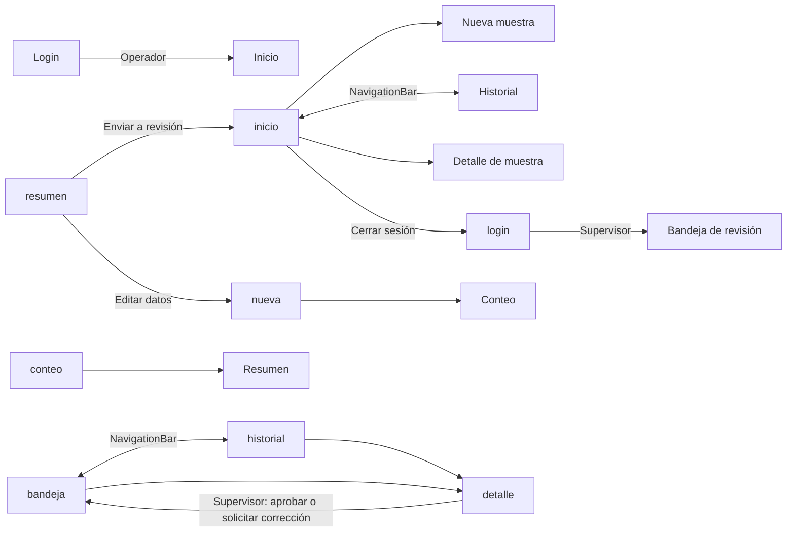
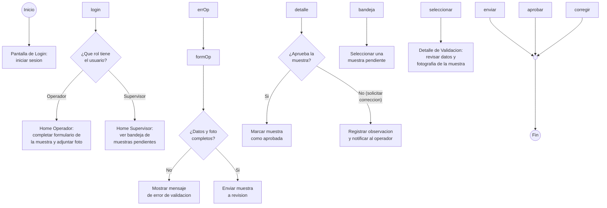

# AquaSample

Aplicación móvil para registrar y validar muestras de terreno en Aldemar SpA, con dos roles: **Operador de Muestreo** y **Supervisor Técnico** (MVP académico — DSY1105, La Brigada Fantasma).

## Problema que aborda

En el muestreo de líneas de cultivo de choritos, el conteo y el registro se hacen de forma manual. Con alta densidad de individuos el proceso es lento y aparecen diferencias de conteo y registros incompletos. Además, los datos, las fotografías y las notas quedan repartidos en archivos distintos, lo que dificulta revisar, corregir y comparar el historial de una misma línea.

AquaSample permite registrar cada muestra con sus datos de trazabilidad (centro, tren, línea, fecha, hora y tramo), su conteo y sus observaciones, revisarla como supervisor y consultar el historial con su estado de revisión.

> MVP académico: todos los usuarios, centros y muestras son \*\*ficticios\*\*. No se usa información real de ALDEMAR.

## Integrantes

|Nombre|Rol|
|-|-|
|Javier Cataldo|Líder de Proyecto y Repositorio (Team Lead)|
|Cristobal Gonzalez|Desarrollador Core y Lógica (Backend)|
|Vicente Barrera|Analista de Calidad y Validaciones (QA Tester)|
|Daniel Vargas|Desarrollador de Interfaz y Flujos (Frontend / UI)|

## Planificación

Las tareas, responsables y avances del equipo se gestionan en Trello: **https://trello.com/b/3lAtfC5W/trello-aquasample**

La lista detallada de pendientes también está en [`TAREAS.md`](TAREAS.md).

## Funcionalidades

* **Login con roles** (Operador y Supervisor) con usuarios ficticios.
* **Registro de muestras** en tres pasos (datos, conteo y resumen), con validación de campos obligatorios y mensajes de error.
* **Conteo manual** de individuos con botones +/− y calibre promedio opcional. La app no cuenta automáticamente.
* **Historial** con búsqueda de texto y filtros por fecha, centro, línea y estado de revisión.
* **Detalle de muestra** con todos sus datos y el comentario del supervisor.
* **Revisión del supervisor:** bandeja de muestras por revisar, con acciones para aprobar o solicitar corrección.
* **Corrección del operador:** el operador puede marcar como corregida una muestra observada.
* **Persistencia local con Room (SQLite):** las muestras se conservan al cerrar la app.
* **Exportación a CSV** con el selector de documentos de Android.

## Identidad visual

!\[Logo de AquaSample](docs/diseno/logo.png)

|Color|HEX|Uso|
|-|-|-|
|Principal|`#00695C`|TopAppBar, botones principales, iconos activos|
|Secundario|`#26A69A`|Acentos, tarjetas de listado|
|Fondo|`#F4FAF9`|Fondo general de las pantallas|
|Texto|`#1B1B1B`|Texto principal|
|Adicional|`#FFB300`|Alertas y estado "pendiente" en la bandeja|

La paleta está aplicada en el tema de la app (`ui/theme/Color.kt` y `ui/theme/Theme.kt`), con versión para modo oscuro. El color dinámico de Android 12+ está desactivado para que la app mantenga siempre esta identidad.

## Arquitectura: MVVM

```
app/src/main/java/com/example/aquasample/
├── MainActivity.kt          → inicializa la base de datos, aplica el tema y carga AquaSampleApp
├── model/                   → entidades de datos
├── data/                    → datos ficticios, repositorio y exportación a CSV
│   └── local/               → Room: entidad, DAO y base de datos
├── viewmodel/               → ViewModels y estado de las pantallas (StateFlow)
└── ui/
    ├── navigation/          → Rutas y NavHost (AppNavegacion)
    ├── screens/             → una pantalla por archivo
    ├── components/          → componentes reutilizables
    └── theme/               → colores, tipografía y tema Material 3
```

* **Model:** clases de datos sin lógica de pantalla.
* **ViewModel:** guarda el estado (`UiState` + `StateFlow`), valida los campos y llama al repositorio.
* **View (Compose):** las pantallas observan el estado con `collectAsState()` y envían las acciones del usuario al ViewModel.
* **Repository:** `MuestraRepository` guarda y lee las muestras desde Room (SQLite) y las expone como `StateFlow`, así las pantallas se actualizan solas y los datos se conservan al cerrar la app.

### Modelos principales (`model/`)

|Modelo|Descripción|
|-|-|
|`Usuario`|Usuario ficticio con nombre, usuario, clave y rol|
|`Rol`|`OPERADOR` o `SUPERVISOR`|
|`Centro`|Centro de cultivo|
|`Tren`|Tren de cultivo, pertenece a un centro|
|`Linea`|Línea de cultivo, pertenece a un tren|
|`Muestra`|Centro, tren, línea, fecha, hora, tramo, operador, conteo, observaciones, estado, comentario del supervisor y `fotoUri` (reservado para la etapa de fotografías)|
|`Conteo`|Cantidad de individuos y calibre promedio (opcional)|
|`EstadoRevision`|`PENDIENTE`, `OBSERVADO`, `CORREGIDO` o `VALIDADO`|

### ViewModels (`viewmodel/`)

|ViewModel|Pantallas|Responsabilidad|
|-|-|-|
|`LoginViewModel`|Login|Valida usuario y clave ficticios y guarda el usuario de la sesión|
|`MuestraViewModel`|Nueva muestra, Conteo, Resumen, Inicio, Detalle, Bandeja|Formulario compartido de la muestra, validaciones, envío a revisión y acciones de revisión (aprobar, solicitar corrección, marcar corregida)|
|`HistorialViewModel`|Historial|Búsqueda de texto y filtros por fecha, centro, línea y estado de revisión|

## Pantallas implementadas

|Pantalla|Archivo|Qué hace|
|-|-|-|
|Login|`LoginScreen.kt`|Ingreso con usuarios ficticios; el rol se detecta según el usuario|
|Inicio|`InicioScreen.kt`|Saludo, botón "Registrar nueva muestra" (operador) y lista de muestras|
|Nueva muestra|`NuevaMuestraScreen.kt`|Centro, tren, línea, fecha, hora, tramo y observaciones, con validación|
|Conteo|`ConteoScreen.kt`|Conteo de individuos con botones +/− y calibre opcional|
|Resumen|`ResumenScreen.kt`|Revisión de los datos y envío de la muestra a revisión|
|Historial|`HistorialScreen.kt`|Búsqueda, filtros y exportación a CSV|
|Bandeja de revisión|`BandejaSupervisorScreen.kt`|Home del supervisor: muestras pendientes y corregidas por revisar|
|Detalle de muestra|`DetalleMuestraScreen.kt`|Datos completos de la muestra y acciones de revisión según el rol|

Componentes Material 3 utilizados: `Scaffold`, `TopAppBar`, `NavigationBar`, `Card`, `Button`, `OutlinedButton`, `TextButton`, `IconButton`, `OutlinedTextField`, `DropdownMenu`, `FilterChip`, `HorizontalDivider` y `Text`.

### Usuarios de prueba

|Usuario|Clave|Rol|
|-|-|-|
|`operador1`|`1234`|Operador de muestreo|
|`operador2`|`1234`|Operador de muestreo|
|`supervisor1`|`1234`|Supervisor técnico|

La primera vez que se abre la app se cargan 5 muestras ficticias de ejemplo con distintos estados de revisión, para que Inicio e Historial muestren datos desde el primer ingreso.

## Persistencia local con Room

Las muestras se guardan en una base de datos SQLite con Room (`aquasample.db`, tabla `muestras`), por lo que se conservan al cerrar y volver a abrir la app. La primera vez que se abre, si la tabla está vacía, se cargan las muestras ficticias de ejemplo.

|Pieza|Archivo|Qué hace|
|-|-|-|
|Entidad|`data/local/MuestraEntity.kt`|Define la tabla `muestras`. Guarda los ids de centro, tren, línea y operador (el catálogo ficticio está en `DatosFicticios`) y el estado como texto. Incluye funciones para convertir entre entidad y modelo `Muestra`|
|DAO|`data/local/MuestraDao.kt`|Consultas SQL: listar (como `Flow`), buscar por id, contar, insertar y actualizar el estado|
|Base de datos|`data/local/AppDatabase.kt`|Une la entidad con el DAO y crea el archivo de la base de datos|
|Repositorio|`data/MuestraRepository.kt`|Intermediario entre los ViewModels y Room. Expone las muestras como `StateFlow` y escribe en segundo plano con corrutinas|

Flujo de un dato: el ViewModel llama al repositorio, el repositorio convierte la muestra a entidad y el DAO la inserta. Como el listado es un `Flow`, la interfaz se actualiza sola cuando cambia la tabla. El campo `fotoUri` de la muestra queda preparado para la etapa de fotografías.

## Revisión del supervisor

En el detalle de una muestra (se llega desde la bandeja del supervisor, el Inicio o el Historial):

* **Supervisor:** en muestras *Pendientes* o *Corregidas* aparece el panel "Revisión del supervisor". **Aprobar muestra** la pasa a *Validado*. **Solicitar corrección** la pasa a *Observado* y exige un comentario; si está vacío se muestra un mensaje de error.
* **Operador:** en sus muestras *Observadas* puede ver el comentario del supervisor y presionar **Marcar como corregida**, con lo que vuelve a la bandeja del supervisor con estado *Corregido*.

Todos los cambios de estado se guardan en Room.

## Exportación a CSV

En el Historial, el botón **Exportar a CSV** abre el selector de documentos de Android (`ActivityResultContracts.CreateDocument`) para elegir dónde guardar `muestras\_aquasample.csv`. No requiere permisos, porque la app solo escribe en el archivo que el usuario elige.

* Exporta las muestras que se ven en pantalla: si hay filtros o búsqueda activos, solo esas.
* Columnas: id, centro, tren, línea, fecha, hora, tramo, operador, individuos, calibre, estado, observaciones y comentario del supervisor.
* Separador `;` y codificación UTF-8 con BOM, para que Excel en español lo abra en columnas y con tildes correctas.
* Implementación en `data/ExportadorCsv.kt`.

## Flujo de navegación actual

Implementado con **Navigation Compose** (`NavController` + `NavHost`, rutas en `ui/navigation/Rutas.kt`):



* **NavigationBar del operador:** Inicio · Nueva muestra · Historial.
* **NavigationBar del supervisor:** Bandeja · Historial.
* Desde Conteo, Resumen y Detalle se puede volver con el botón de la TopAppBar o con el botón "atrás" del teléfono.
* Si faltan campos obligatorios, la app no avanza y muestra el error debajo del campo.

## Flujo de usuario diseñado (Diagrama de Actividad UML — Clase 2)



> La bandeja y la revisión del supervisor ya están implementadas. La fotografía de la muestra forma parte del diseño, pero queda fuera de esta etapa.

### Wireframes

Ver diseños en `docs/diseno/interfaces/`:

* Pantalla de Login — `wireframe\_1\_login.png`
* Home Operador — `wireframe\_2\_home\_operador.png`
* Home Supervisor — `wireframe\_3\_home\_supervisor.png`
* Detalle de Validación — `wireframe\_4\_detalle\_validacion.png`

> Interfaces generadas con Stitch IA y ajustadas por el equipo a la paleta de AquaSample.

## Capturas de la aplicación

> Pendiente: agregar en `docs/capturas/` las capturas del recorrido Login → Inicio → Nueva muestra → Conteo → Resumen → Historial → Detalle/Bandeja del supervisor, la tabla `muestras` en el Database Inspector y el CSV exportado.

## Avance por rama

|Rama|Responsable|Contenido|
|-|-|-|
|`feature/modelos-viewmodel`|Cristobal Gonzalez|Modelos, datos ficticios, `MuestraRepository`, `LoginViewModel` y `MuestraViewModel`|
|`feature/pantallas-navegacion`|Daniel Vargas|Pantallas Login, Inicio, Nueva muestra, Conteo y Resumen; NavHost, TopAppBar y NavigationBar|
|`feature/historial`|Vicente Barrera|Paleta de colores del equipo en el tema, muestras ficticias de ejemplo, pantalla Historial con filtros y `HistorialViewModel`; actualización del README|
|`feature/room-database`|Cristobal Gonzalez|Room: entidad, DAO, base de datos y `MuestraRepository` respaldado por la base de datos|
|`feature/historial-detalle-supervisor`|Daniel Vargas|Búsqueda de texto y filtro por fecha, detalle de muestra, bandeja del supervisor y estado vacío|
|`feature/revision-supervisor`|Cristobal Gonzalez|Aprobar, solicitar corrección y marcar corregida, con persistencia en Room|
|`feature/exportar-csv`|Cristobal Gonzalez|Exportación de muestras a CSV con el selector de documentos de Android|

## Cómo ejecutar el proyecto

1. Clonar el repositorio: `git clone https://github.com/Catal2s/AquaSample-DSY1105.git`
2. Abrir la carpeta en Android Studio y esperar a que termine el Sync de Gradle.
3. Ejecutar la app (botón **Run**) en un emulador o dispositivo con Android 7.0 (API 24) o superior.
4. Ingresar con alguno de los usuarios de prueba (ver más arriba).

## Fuera del alcance de esta etapa

Cámara o galería, conteo automático por imágenes, API REST, autenticación real e integración con sistemas de ALDEMAR.

## Tecnologías

Kotlin · Jetpack Compose · Material Design 3 · Arquitectura MVVM · Navigation Compose · StateFlow y corrutinas · Room (SQLite) con KSP.

