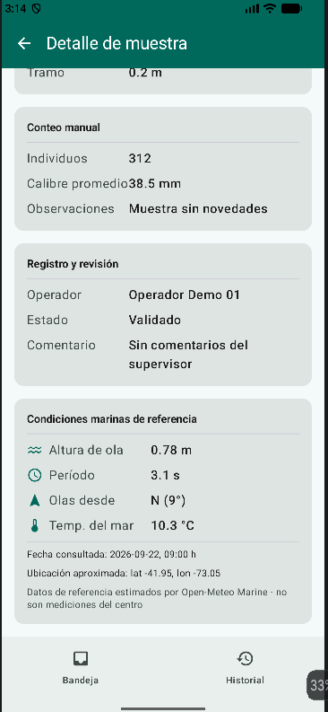

# API externa: Open-Meteo Marine

## Qué es y para qué la usamos

[Open-Meteo Marine](https://open-meteo.com/en/docs/marine-weather-api) es una API pública con datos del mar hora por hora. La usamos sin clave ni cuenta.

En el detalle de cada muestra, la tarjeta **"Condiciones marinas de referencia"** muestra cómo estaba el mar ese día. También sirve para fechas pasadas.

**Son datos de referencia, no mediciones.** Los estima un modelo para una zona del mar, no un sensor en el centro de cultivo. Además, nuestras coordenadas son aproximadas. La tarjeta siempre lo avisa.

## Cómo está hecho en la app

`TarjetaCondicionesMarinas` → `CondicionesMarinasViewModel` → `CondicionesMarinasRepositoryOpenMeteo` → `OpenMeteoMarineApi` (Retrofit)

El cliente es `ClienteOpenMeteo`, separado de `ClienteBackend`: si Open-Meteo falla, no afecta la sincronización. Espera hasta 10 s para conectar, 15 s para leer y 25 s en total.

## URL y parámetros

`GET https://marine-api.open-meteo.com/v1/marine`

| Parámetro | Valor |
|---|---|
| `latitude`, `longitude` | Coordenadas del centro (`UbicacionesCentros.kt`) |
| `start_date`, `end_date` | La fecha de la muestra en ambos (`yyyy-MM-dd`) |
| `hourly` | `wave_height,wave_period,wave_direction,sea_surface_temperature` |
| `timezone` | `America/Santiago` |

| Variable | Qué es | Unidad | En la tarjeta |
|---|---|---|---|
| `wave_height` | Altura de ola | m | Altura de ola |
| `wave_period` | Período de las olas | s | Período |
| `wave_direction` | Dirección **desde** la que vienen (0 = norte, 90 = este) | ° | Olas desde |
| `sea_surface_temperature` | Temperatura de la superficie del mar | °C | Temp. del mar |

Si una variable viene en `null`, la tarjeta muestra "Sin dato".

## Coordenadas

Están en `UbicacionesCentros.kt`. Los centros son **ficticios**: son puntos aproximados en el mar del sur de Chile (sector de Calbuco y Chiloé) y no corresponden a centros reales de ninguna empresa.

| Centro | Nombre en la app | Latitud | Longitud |
|---|---|---|---|
| C1 | Centro Ficticio Norte | -41.95 | -73.05 |
| C2 | Centro Ficticio Sur | -42.60 | -73.50 |

En el ejemplo de abajo la respuesta trae coordenadas un poco distintas a las pedidas. La tarjeta muestra las nuestras.

## Cómo se elige la hora

Lo hace la función `aCondiciones` con las horas del día que devuelve la API:

1. Se descartan las horas que tienen las cuatro variables en `null`.
2. Se usa la hora más cercana a la de la muestra. Si hay empate, la anterior (10:30 usa 10:00).
3. Si la muestra no tiene una hora válida, se usa la hora con la ola más alta del día.

## Qué pasa si falla

| Situación | Mensaje en la tarjeta |
|---|---|
| Sin internet | Sin conexión. Conéctate a internet para ver las condiciones marinas. |
| Tarda demasiado | El servicio tardó demasiado en responder. |
| Fecha fuera de rango (400) | La fecha está fuera del rango disponible en Open-Meteo. |
| Otro error HTTP | Open-Meteo respondió con un error (código). |
| Sin datos para esa fecha | Open-Meteo no tiene datos para esta fecha. |
| JSON inválido o vacío | La respuesta de Open-Meteo no es válida. |
| Centro sin coordenadas | Este centro no tiene una ubicación de referencia. |

En todos los casos aparece **Reintentar** y el resto del detalle sigue funcionando. Las condiciones no se guardan en Room, así que sin internet no se pueden ver al volver a abrir la app.

## Ejemplo real

Muestra #1: centro C1, 2026-09-22 a las 09:15. Consulta hecha con curl el 24-11-2026:

```bash
curl "https://marine-api.open-meteo.com/v1/marine?latitude=-41.95&longitude=-73.05&start_date=2026-09-22&end_date=2026-09-22&hourly=wave_height,wave_period,wave_direction,sea_surface_temperature&timezone=America/Santiago"
```

Respuesta completa (solo se ordenó en líneas para leerla mejor):

```json
{
  "latitude": -41.958336,
  "longitude": -73.04166,
  "generationtime_ms": 0.8639097213745117,
  "utc_offset_seconds": -10800,
  "timezone": "America/Santiago",
  "timezone_abbreviation": "GMT-3",
  "elevation": 0.0,
  "hourly_units": {
    "time": "iso8601",
    "wave_height": "m",
    "wave_period": "s",
    "wave_direction": "°",
    "sea_surface_temperature": "°C"
  },
  "hourly": {
    "time": ["2026-09-22T00:00","2026-09-22T01:00","2026-09-22T02:00","2026-09-22T03:00","2026-09-22T04:00","2026-09-22T05:00","2026-09-22T06:00","2026-09-22T07:00","2026-09-22T08:00","2026-09-22T09:00","2026-09-22T10:00","2026-09-22T11:00","2026-09-22T12:00","2026-09-22T13:00","2026-09-22T14:00","2026-09-22T15:00","2026-09-22T16:00","2026-09-22T17:00","2026-09-22T18:00","2026-09-22T19:00","2026-09-22T20:00","2026-09-22T21:00","2026-09-22T22:00","2026-09-22T23:00"],
    "wave_height": [0.24,0.22,0.20,0.18,0.26,0.32,0.40,0.52,0.66,0.78,0.86,0.96,1.04,1.08,1.14,1.18,1.22,1.24,1.28,1.30,1.32,1.34,1.34,1.36],
    "wave_period": [2.25,2.25,2.30,2.30,2.30,2.30,2.35,2.55,2.85,3.10,3.35,3.55,3.75,3.90,4.00,4.05,4.10,4.10,4.15,4.20,4.25,4.30,4.35,4.35],
    "wave_direction": [297,303,309,315,330,345,0,3,6,9,11,13,15,17,19,21,20,20,19,17,16,14,13,11],
    "sea_surface_temperature": [10.3,10.3,10.3,10.3,10.3,10.3,10.3,10.3,10.3,10.3,10.3,10.3,10.3,10.3,10.3,10.3,10.3,10.3,10.4,10.4,10.4,10.4,10.4,10.4]
  }
}
```

La hora más cercana a 09:15 es 09:00: **0.78 m, 3.10 s, 9° y 10.3 °C**. Es lo mismo que muestra la tarjeta: 0.78 m, 3.1 s, N (9°) y 10.3 °C.

Con una fecha fuera de rango (`2027-06-01`) respondió:

```json
{"error":true,"reason":"Parameter 'start_date' is out of allowed range from 1940-01-01 to 2026-12-09"}
```

## Capturas

Tarjeta con los datos de la muestra #1. Se tomó antes de integrar el dashboard y la sincronización, por eso el resto de la pantalla se ve distinto a la versión actual:



Sin conexión: captura pendiente.

<!-- Cuando exista la captura, reemplazar la línea anterior por:

-->

---

[Arquitectura](ARQUITECTURA.md) · [índice](README.md)
