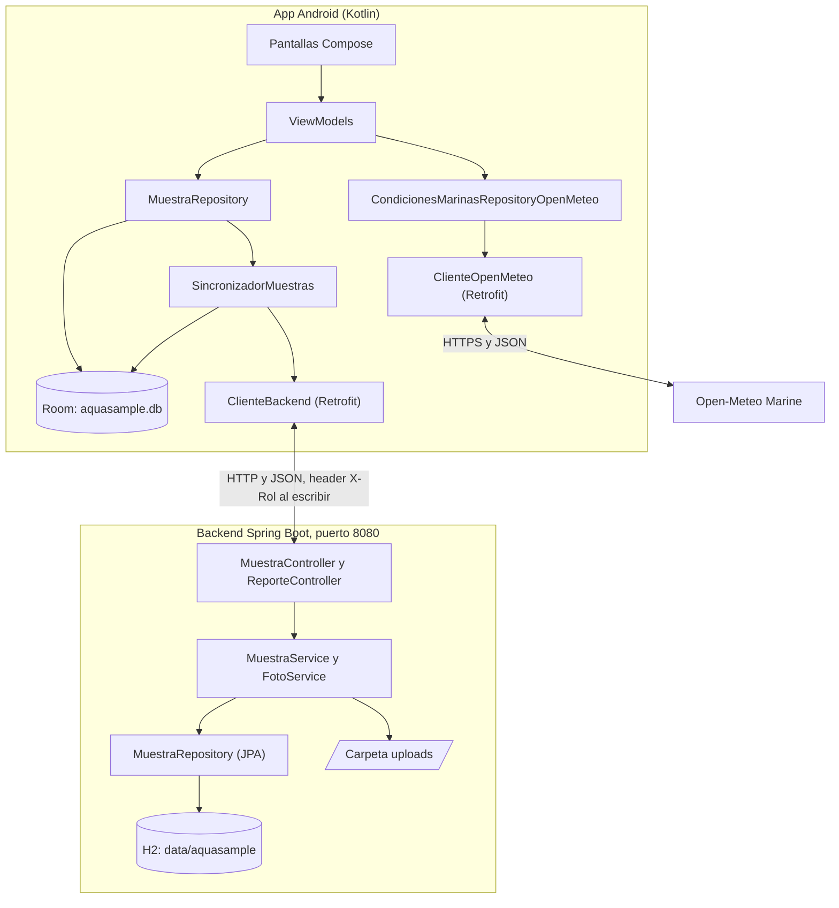
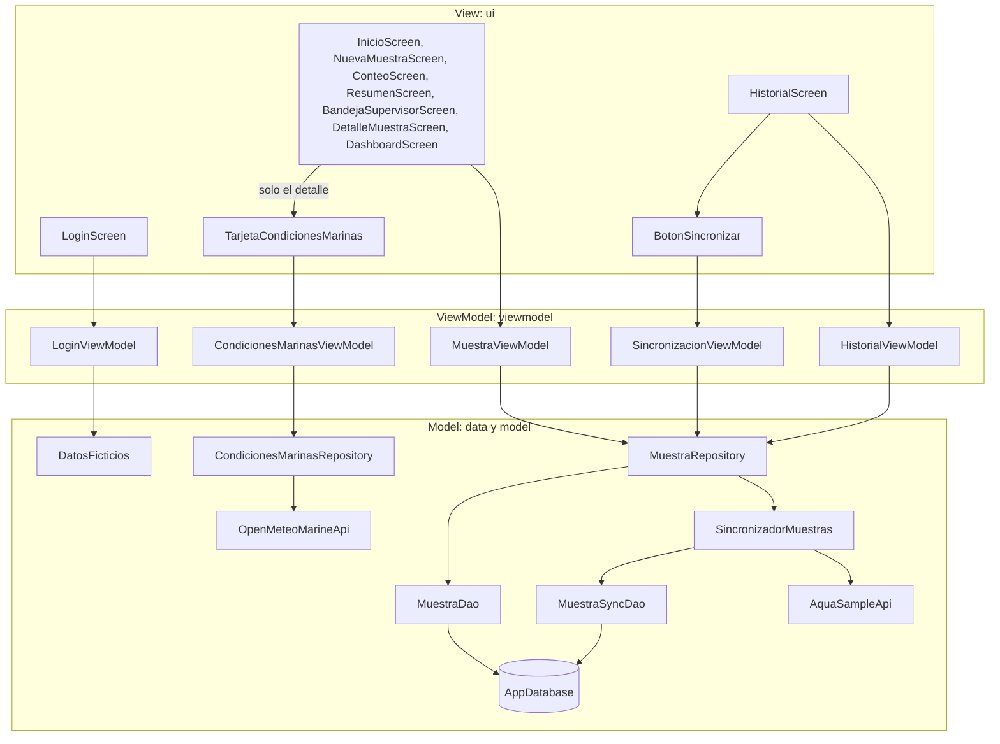
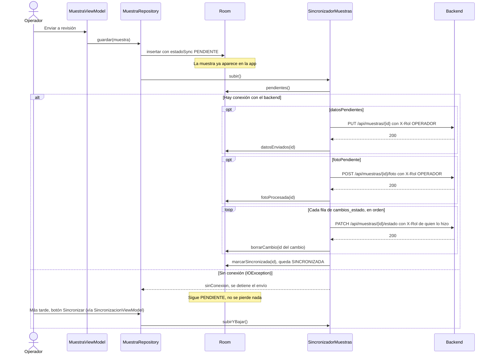
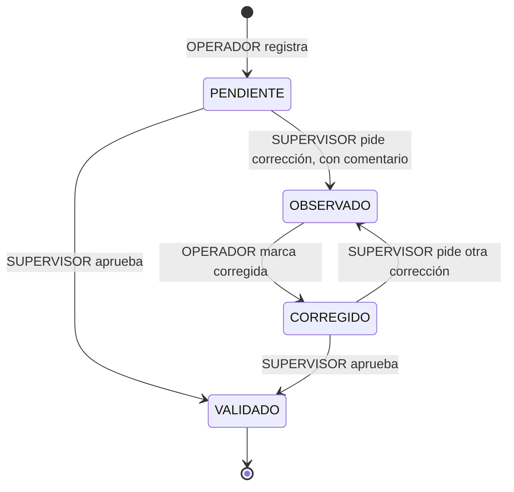
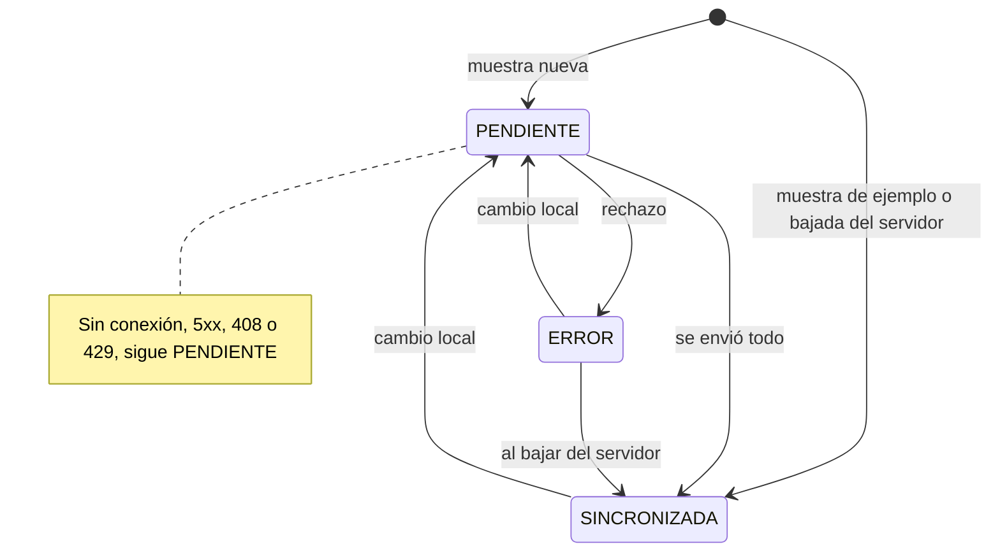
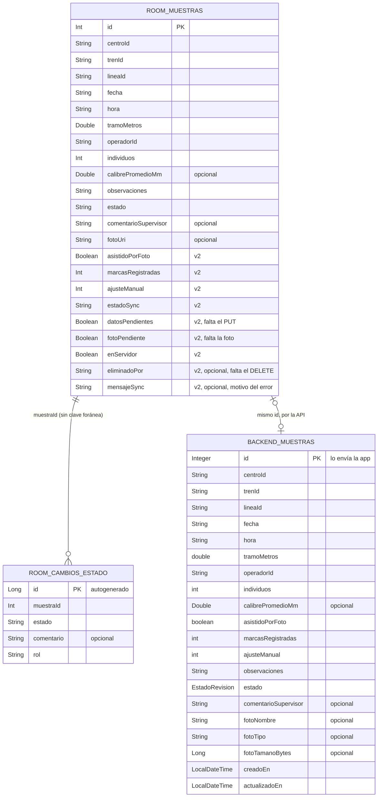

# Arquitectura de AquaSample

Diagramas de la app Android, el backend y la API externa. Describen el código de `main` al 24-11-2026.

- [1. Arquitectura general](#1-arquitectura-general)
- [2. Capas MVVM de la app](#2-capas-mvvm-de-la-app)
- [3. Secuencia de la sincronización](#3-secuencia-de-la-sincronización)
- [4. Estados de la revisión](#4-estados-de-la-revisión)
- [5. Estados de la sincronización](#5-estados-de-la-sincronización)
- [6. Modelo de datos](#6-modelo-de-datos)

## 1. Arquitectura general

La app no necesita internet para registrar muestras: todo se guarda primero en Room y después se envía al backend.
El backend está separado en capas: el Controller recibe la petición, el Service aplica las reglas y el Repository guarda en H2.
Hay dos clientes Retrofit independientes, uno para nuestro backend y otro para Open-Meteo. Si uno falla, el otro sigue funcionando.
Las condiciones marinas se consultan en el momento y no se guardan en Room.

## 2. Capas MVVM de la app

Cada pantalla observa el estado de su ViewModel con `StateFlow` y le avisa lo que hizo el usuario. La pantalla no llama a Room ni a Retrofit.
El ViewModel valida y le pide los datos al repositorio. El repositorio decide de dónde salen: Room o internet.
El login usa los usuarios de `DatosFicticios`, por eso no pasa por el backend.
Para no llenar el diagrama se omitió que varias pantallas también usan `LoginViewModel` para saber quién inició sesión.

## 3. Secuencia de la sincronización

Una muestra nueva usa el PUT (con el id de la app, para no duplicar al reintentar) y, si tiene foto, el POST. El PATCH se usa cuando alguien la revisa o la marca como corregida.
Un error 5xx, 408 o 429 también la deja PENDIENTE. Un rechazo (400, 403, 404 o 409) la deja en ERROR, salvo que el 409 sea de un envío que ya había llegado.
El botón Sincronizar primero sube y después baja `GET /api/muestras`, sin pisar los cambios locales pendientes. Si se elimina una muestra, se envía un DELETE.
Hoy el envío se intenta al guardar, revisar o eliminar, y con el botón. Todavía no hay WorkManager que reintente solo.

## 4. Estados de la revisión

El camino con corrección es PENDIENTE, OBSERVADO, CORREGIDO y VALIDADO, pero el supervisor también puede aprobar directo.
El backend revisa el rol del header `X-Rol`: si no corresponde responde 403, y si el cambio no es válido desde el estado actual responde 409.
Una muestra VALIDADO ya no se puede editar ni cambiar de estado. Pedir el estado que ya tiene, con el rol correcto, responde 200 sin cambios.
El rol ANALISTA existe en el backend y solo consulta. La app tiene solamente OPERADOR y SUPERVISOR.

## 5. Estados de la sincronización

PENDIENTE significa que falta enviar algo. Un cambio local es revisar, corregir o eliminar la muestra.
ERROR significa que el servidor rechazó el envío o no se pudo leer la foto (el motivo queda en `mensajeSync`). No se reintenta sola, porque daría lo mismo.
Al bajar, una muestra en ERROR cuyos datos ya habían llegado se reemplaza por la del servidor. Si nunca llegaron, se conserva la copia local.
Al bajar también se borran las SINCRONIZADA que ya no están en el servidor, salvo que el servidor venga sin ninguna muestra.

## 6. Modelo de datos

En Room las tablas se llaman `muestras` y `cambios_estado` (entidades `MuestraEntity` y `CambioEstadoEntity`). En el backend hay una sola tabla, `muestras`.
Son dos bases distintas: no hay clave foránea entre ellas, se relacionan por el mismo `id`. Los nombres son los del código; en H2 las columnas quedan como `CENTRO_ID`.
`cambios_estado` es una lista de PATCH por enviar. Es una tabla aparte porque sin internet se pueden acumular varios y hay que mandarlos en orden.
Room está en la versión 2. `MIGRACION_1_2` agrega las columnas marcadas "v2" y la tabla `cambios_estado` sin borrar muestras. La imagen no está en ninguna base, solo su ruta o nombre.

---

Más detalle: [contrato de la API](API_CONTRATO.md) · [API externa](API_EXTERNA.md) · [instalación](INSTALACION.md) · [índice](README.md)
