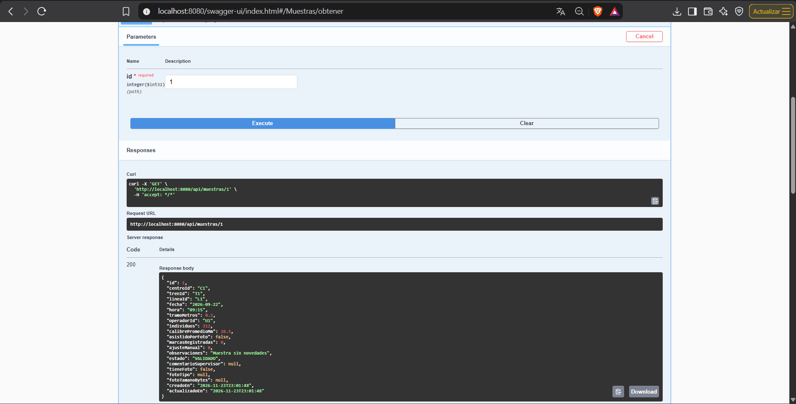
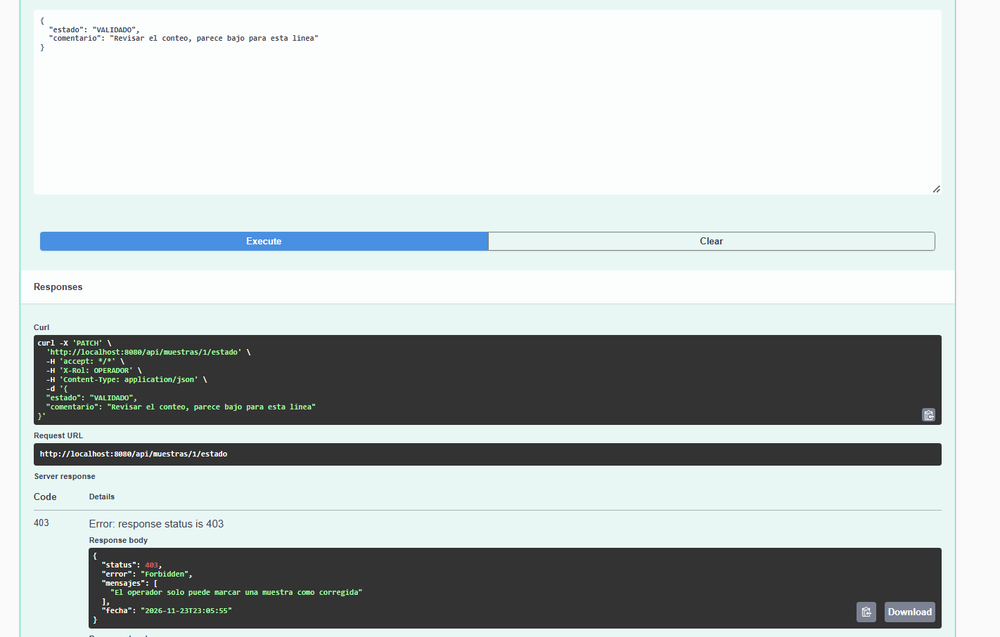
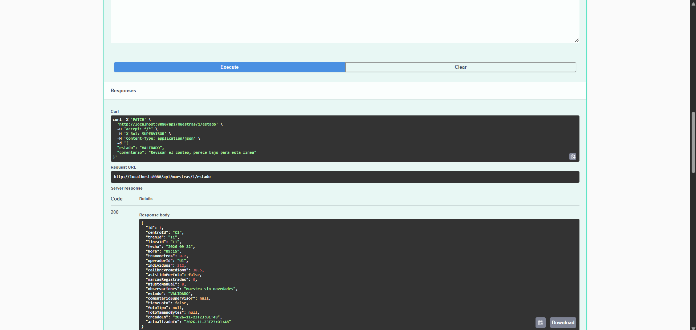
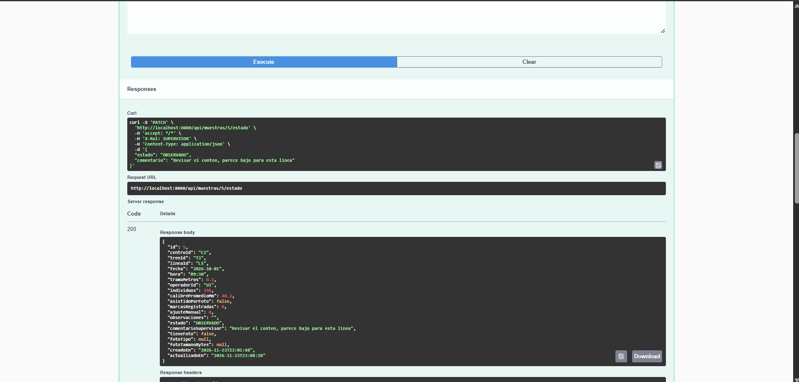

# Pruebas del backend: roles y ciclo de revisión

Evidencia del indicador **IE 3.1.2** (microservicio con base de datos y endpoints funcionales).

- **Responsable:** Cristobal Gonzalez (Backend)
- **Fecha:** 23-11-2026
- **Rama:** `feature/backend-spring`
- **Herramientas:** Swagger UI (capturas) y curl ([pruebas-curl.md](pruebas-curl.md))
- **Datos:** las 5 muestras ficticias que carga el backend

## Ciclo de revisión

Una muestra nueva queda **PENDIENTE**. El supervisor la valida o la marca **OBSERVADO** con un comentario obligatorio. El operador corrige los datos (PUT) y la marca **CORREGIDO** (PATCH). Al final el supervisor la deja **VALIDADO** y ya no se puede editar.

**¿Por qué el 200 sin cambios es correcto?** Si el supervisor pide VALIDADO y la muestra ya está validada, el backend responde 200 y no modifica nada (en la captura 03, `actualizadoEn` sigue igual que en la 01). Esto es idempotencia: si se pierde internet y la sincronización reintenta el envío, repetirlo no da error ni cambia los datos.

## Resultados

| # | Prueba | Endpoint | Rol | Esperado | Obtenido | Evidencia |
|---|---|---|---|---|---|---|
| 1 | Consultar una muestra | GET `/api/muestras/1` | No necesita | 200 con la muestra | ✅ 200 | [Captura 01](01-swagger-get-muestra.png) |
| 2 | Operador intenta validar | PATCH `/api/muestras/1/estado` | OPERADOR | 403 | ✅ 403 | [Captura 02](02-patch-operador-403.png) |
| 3 | Validar una muestra ya validada | PATCH `/api/muestras/1/estado` | SUPERVISOR | 200 sin cambios | ✅ 200 sin cambios | [Captura 03](03-patch-supervisor-sin-cambios.png) |
| 4 | Observar sin comentario | PATCH `/api/muestras/4/estado` | SUPERVISOR | 400 y la muestra no cambia | ✅ 400, sigue CORREGIDO | [curl 1 y 2](pruebas-curl.md) |
| 5 | Observar con comentario (parte en PENDIENTE) | PATCH `/api/muestras/5/estado` | SUPERVISOR | 200, OBSERVADO | ✅ 200, OBSERVADO | [Captura 04](04-patch-supervisor-observado.png) y [curl 3 y 4](pruebas-curl.md) |
| 6 | Corregir los datos | PUT `/api/muestras/5` | OPERADOR | 200, sigue OBSERVADO | ✅ 200, individuos 298 → 310 | [curl 5](pruebas-curl.md) |
| 7 | Marcar como corregida | PATCH `/api/muestras/5/estado` | OPERADOR | 200, CORREGIDO | ✅ 200, CORREGIDO | [curl 6](pruebas-curl.md) |
| 8 | Validar la corrección | PATCH `/api/muestras/5/estado` | SUPERVISOR | 200, VALIDADO | ✅ 200, VALIDADO | [curl 7](pruebas-curl.md) |
| 9 | Resumen para el dashboard | GET `/api/reportes/resumen` | No necesita | 200 con los totales actualizados | ✅ 200, 3 validadas y 0 pendientes | [curl 8](pruebas-curl.md) |

La prueba 4 se hizo con la muestra 4 y no con la 2, porque la 2 ya parte en OBSERVADO y ahí el backend responde 200 sin cambios.

Las capturas y las pruebas con curl son de dos ejecuciones distintas. Las de curl usaron una base de datos temporal, por eso empiezan de nuevo con la muestra 5 en PENDIENTE.

## Capturas

### 01. GET de la muestra 1 (200)

### 02. Operador intenta validar (403)

### 03. Supervisor valida una muestra ya validada (200 sin cambios)

### 04. Supervisor observa la muestra 5 (200)

